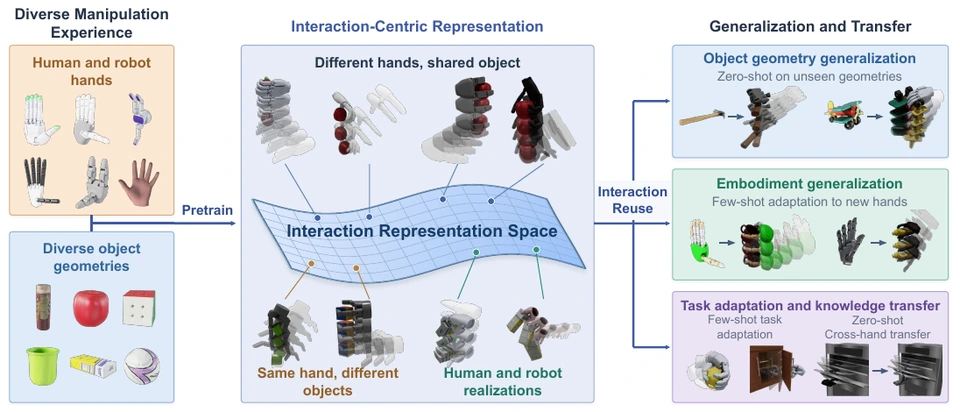
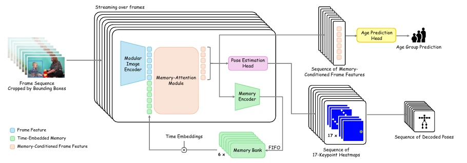
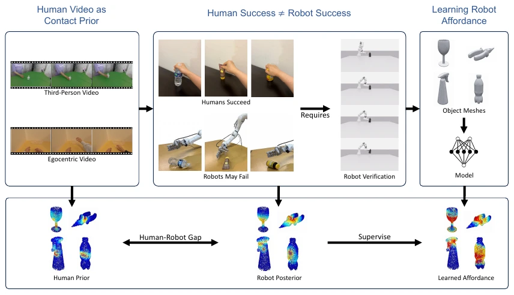
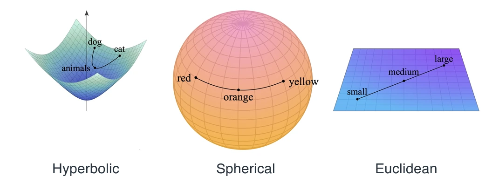

```{=html}
<div id="top" class="site-shell">
<header class="profile-rail">
  <div class="rail-topbar">
    <a class="rail-brand" href="#top" aria-label="Jiakai Chen, home">
      <span>Jiakai Chen</span>
    </a>
    <div class="rail-topbar-actions">
      <button id="theme-toggle-mobile" class="rail-theme-toggle rail-mobile-theme-toggle" type="button" aria-label="Theme: Auto" title="Theme: Auto">
        <i class="bi bi-circle-half"></i>
      </button>
      <button id="menu-toggle" class="rail-menu-toggle" type="button" aria-label="Toggle navigation" aria-expanded="false" title="Toggle navigation">
        <i class="bi bi-list"></i>
      </button>
    </div>
  </div>

  <nav class="rail-nav" aria-label="Primary navigation">
    <a href="#about">About</a>
    <a href="#news">News</a>
    <a href="#research-projects">Research</a>
    <a href="#other-experience">Other Experience</a>
    <button id="theme-toggle" class="rail-theme-toggle rail-nav-theme-toggle" type="button" aria-label="Theme: Auto" title="Theme: Auto">
      <i class="bi bi-circle-half"></i>
    </button>
  </nav>
</header>

<div class="main-column">
  <section id="about" class="content-card section-grid about-section" aria-labelledby="about-title">
    <div class="section-label">
      <h2 id="about-title">About</h2>
    </div>
    <div class="hero-aside">
      <a class="image-trigger portrait-trigger" href="assets/img/portrait.jpg" aria-label="Enlarge portrait of Jiakai Chen">
        
      </a>
      <div class="bio-copy">
        <p>I am a Master of Computer Science student at the <strong>University of Illinois Urbana-Champaign (UIUC)</strong> and a robot learning researcher with the <a href="https://msc.berkeley.edu/" target="_blank" rel="noopener noreferrer">MSC Lab</a> at <strong>UC Berkeley</strong>, working with Prof. <a href="https://msc.berkeley.edu/people/tomizuka.html" target="_blank" rel="noopener noreferrer">Masayoshi Tomizuka</a>, Dr. <a href="https://zhanwei.site/" target="_blank" rel="noopener noreferrer">Wei Zhan</a>, and Dr. <a href="https://warshallrho.github.io/" target="_blank" rel="noopener noreferrer">Ruihai Wu</a>.</p>
        <p><u>I am seeking Fall 2027 Ph.D. opportunities</u> and spring or summer internships in robotics and AI. I welcome conversations about research and collaborations—please feel free to reach out.</p>
      </div>
    </div>
    <div class="hero-contact" aria-label="Contact links">
      <a href="mailto:jiakaic3@illinois.edu">Email <span aria-hidden="true">↗</span></a>
      <a href="https://github.com/jiaka1chen" target="_blank">GitHub <span aria-hidden="true">↗</span></a>
      <a href="https://www.linkedin.com/in/jiaka1chen" target="_blank">LinkedIn <span aria-hidden="true">↗</span></a>
      <a href="https://scholar.google.com/citations?user=ADQwpyMAAAAJ&amp;hl=en" target="_blank" rel="noopener noreferrer">Google Scholar <span aria-hidden="true">↗</span></a>
    </div>
    <section class="research-vision" aria-labelledby="vision-title">
      <h3 id="vision-title">Research Interest</h3>
      <p>Foundation models and general-purpose agents bring internet-scale priors and deliberate reasoning, yet physical robots operate under strict real-time latency and safety constraints. My research aims to understand <strong class="research-highlight">what representations transfer across humans and embodiments</strong> and <strong class="research-highlight">where general-purpose agents belong in the robotics stack</strong>, connecting three stages into <strong class="research-highlight">one closed loop</strong>:</p>
      <ul>
        <li><strong>Human &amp; Cross-Embodiment Priors</strong> — While LLMs have unlocked internet-scale text, robotics remains bottlenecked by robot-data scarcity. This motivates structured, transferable representations that turn abundant human data and diverse embodiments into reusable physical and behavioral priors for robotic manipulation.</li>
        <li><strong>From Slow Agents to Fast Representations &amp; Models</strong> — General-purpose agents can already orchestrate simulators, plan over long horizons, and even directly control robots, yet remain far too slow for real-time physical interaction. A central question is how to transform these deliberate capabilities into faster representations, models, and execution paradigms.</li>
        <li><strong>Agent-Driven Real-World Robotics Loops</strong> — Closing the loop in the physical world by empowering agents to drive end-to-end robotics research and engineering, autonomously conducting exploration, hardware rollouts, and systematic evaluation within explicit safety boundaries to continually feed grounded experience back into representations and models.</li>
      </ul>
    </section>
    <div class="about-background">
      <p>Prior to starting at UIUC in January 2026, I was a Ph.D. student in Finance at the <strong>University of Rochester</strong>, where I completed my doctoral coursework in good standing before choosing to exit with an M.S. degree at the end of 2025 to pivot full-time into AI and robotics. While my training at Rochester gave me a strong foundation in quantitative reasoning and principled problem formulation, I realized that rather than analyzing markets from the outside, I wanted to build intelligent systems that perceive, reason, and act in the physical world. This experience not only shaped my research perspective, but also gave me the clarity and conviction to pursue the problems that matter most to me.</p>
      <p>Earlier, I received my bachelor’s degree in Financial Technology with a second major in Computer Science from the <strong>University of Hong Kong</strong>, where I built a foundation in quantitative analysis, computing, and machine learning.</p>
    </div>
  </section>

  <section id="news" class="content-card section-grid news-section" aria-labelledby="news-title">
    <div class="section-label">
      <h2 id="news-title">News</h2>
    </div>
    <div class="section-content">
      <ul class="news-list">
        <li class="news-item">
          <time datetime="2026-11"><strong class="research-highlight">Nov 2026</strong></time>
          <p>Released <strong>Real2Worlds2Real: Scaling Self-Improving Agentic Real2Sim2Real for Robot Manipulation</strong> (<a href="https://real2worlds2real.github.io/" target="_blank" rel="noopener noreferrer">Project page</a>, <a href="https://arxiv.org/abs/2611.31098" target="_blank" rel="noopener noreferrer">Paper</a>).</p>
        </li>
        <li class="news-item">
          <time datetime="2026-10">Oct 2026</time>
          <p><strong>ChildPose: Foundation for Children Pose Modeling</strong> has been accepted for poster presentation at NeurIPS 2026. I will present the work in Sydney this December. Please feel free to get in touch.</p>
        </li>
        <li class="news-item">
          <time datetime="2026-10">Oct 2026</time>
          <p>Our team, GeoVAST-HIC at UC Berkeley, won <strong>first place in Industrial Board Assembly</strong> at the <a href="https://rocochallenge.github.io/RoCo-IROS2026/" target="_blank" rel="noopener noreferrer">RoCo Challenge @ IROS 2026</a>.</p>
        </li>
      </ul>
    </div>
  </section>

  <section id="research-projects" class="content-card section-grid projects-section">
    <div class="section-label">
      <span class="section-number">03</span>
      <h2>Research</h2>
      <small class="contribution-note">* Equal contribution</small>
    </div>
    <div class="section-content item-list">
      <article class="project-card project-card--illustrated">
        <header class="project-heading">
          <div class="project-topline">
            <span>Agentic Robotics · Real2Sim2Real</span>
            <span>2026</span>
          </div>
          <h3>Real2Worlds2Real: Scaling Self-Improving Agentic Real2Sim2Real for Robot Manipulation</h3>
          <p class="project-meta project-authors">Jinzhong&nbsp;Gu<sup>*</sup>, <strong>Jiakai&nbsp;Chen</strong><sup>*</sup>, Xinyi&nbsp;Cao<sup>*</sup>, <a href="https://sxy7147.github.io/" target="_blank" rel="noopener noreferrer">Yan&nbsp;Shen</a><sup>*</sup>, <a href="https://suihangke.github.io/" target="_blank" rel="noopener noreferrer">Hangke&nbsp;Sui</a><sup>*</sup>, Shutian&nbsp;Zheng, Xiang&nbsp;Xiao, <a href="https://luhr2003.github.io" target="_blank" rel="noopener noreferrer">Haoran&nbsp;Lu</a>, Fan&nbsp;Xu, Lu&nbsp;Shi, Daochen&nbsp;Shi, Ruihua&nbsp;Zhang, <a href="https://zhanwei.site/" target="_blank" rel="noopener noreferrer">Wei&nbsp;Zhan</a>, <a href="https://msc.berkeley.edu/people/tomizuka.html" target="_blank" rel="noopener noreferrer">Masayoshi&nbsp;Tomizuka</a>, <a href="https://warshallrho.github.io/" target="_blank" rel="noopener noreferrer">Ruihai&nbsp;Wu</a></p>
          <p class="project-meta">arXiv preprint</p>
        </header>
        <div class="project-body">
          <a class="project-media project-media--real2worlds2real image-trigger" href="assets/img/projects/real2worlds2real.mp4" aria-label="Enlarge video: Synchronized manipulation demo in simulation (left) and on the real robot (right).">
            <video src="assets/img/projects/real2worlds2real.mp4" poster="assets/img/projects/real2worlds2real.webp" width="640" height="400" autoplay muted loop playsinline preload="metadata" aria-label="Synchronized manipulation demo in simulation (left) and on the real robot (right)."></video>
            <span class="project-cover-title" aria-hidden="true">
              <span class="project-cover-wordmark">Real<span class="project-cover-number">2</span><span class="project-cover-worlds">Worlds</span><span class="project-cover-number">2</span>Real</span>
              <span class="project-cover-subtitle">Scaling Self-Improving Agentic Real2Sim2Real for Robot Manipulation</span>
            </span>
          </a>
          <div class="project-copy">
            <p class="project-description">Real2Worlds2Real is an end-to-end agentic pipeline that connects simulation world building with manipulation policy learning. From a few real observations, the agent reconstructs a digital twin and generates diverse digital cousins to help policies generalize beyond the original scene. The agent improves over time by using simulation feedback to refine worlds and policies and distilling validated procedures into reusable skills for future tasks.</p>
            <div class="project-links">
              <a class="project-link" href="https://real2worlds2real.github.io/" target="_blank" rel="noopener noreferrer">Project page <span aria-hidden="true">↗</span></a>
              <a class="project-link" href="https://arxiv.org/abs/2611.31098" target="_blank" rel="noopener noreferrer">Read the paper <span aria-hidden="true">↗</span></a>
            </div>
          </div>
        </div>
      </article>
      <article class="project-card project-card--illustrated">
        <header class="project-heading">
          <div class="project-topline">
            <span>Robot learning · Cross-embodiment manipulation</span>
            <span>2026</span>
          </div>
          <h3>Interaction-Centric Representations Across Embodiments for Generalizable Manipulation</h3>
          <p class="project-meta project-authors"><strong>Jiakai&nbsp;Chen</strong>, Fan&nbsp;Nai, <a href="https://suihangke.github.io/" target="_blank" rel="noopener noreferrer">Hangke&nbsp;Sui</a>, <a href="https://shen626.github.io" target="_blank" rel="noopener noreferrer">Mutian&nbsp;Shen</a>, <a href="https://luhr2003.github.io" target="_blank" rel="noopener noreferrer">Haoran&nbsp;Lu</a>, <a href="https://msc.berkeley.edu/people/tomizuka.html" target="_blank" rel="noopener noreferrer">Masayoshi&nbsp;Tomizuka</a>, <a href="https://zhanwei.site/" target="_blank" rel="noopener noreferrer">Wei&nbsp;Zhan</a>, <a href="https://warshallrho.github.io/" target="_blank" rel="noopener noreferrer">Ruihai&nbsp;Wu</a></p>
          <p class="project-meta">Manuscript under review</p>
        </header>
        <div class="project-body">
          <a class="project-media image-trigger" href="assets/img/projects/interaction.webp" aria-label="Enlarge image: Overview of shared hand-object interaction representations across different hands and objects.">
            
          </a>
          <div class="project-copy">
            <p class="project-description">This project learns a shared interaction representation from synthetic robot trajectories, human hand motion, and human-anchored robot trajectories. It supports zero-shot generalization to new objects and few-shot adaptation to new embodiments and tasks with frozen encoders.</p>
            <span class="project-paper-status">Paper coming soon</span>
          </div>
        </div>
      </article>
      <article class="project-card project-card--illustrated">
        <header class="project-heading">
          <div class="project-topline">
            <span>Pose estimation · Child-centric video pose modeling</span>
            <span>2026</span>
          </div>
          <h3>ChildPose: Foundation for Children Pose Modeling</h3>
          <p class="project-meta project-authors"><strong>Jiakai&nbsp;Chen</strong>, <a href="https://shenyifans.github.io/" target="_blank" rel="noopener noreferrer">Yifan&nbsp;Shen</a>, <a href="https://resurgamm.github.io/" target="_blank" rel="noopener noreferrer">Boyi&nbsp;Li</a>, Chuanmiao&nbsp;Dong, <a href="https://www.irohxucao.com/" target="_blank" rel="noopener noreferrer">Xu&nbsp;Cao</a></p>
          <p class="project-meta">Poster, NeurIPS 2026</p>
        </header>
        <div class="project-body">
          <a class="project-media image-trigger" href="assets/img/projects/childpose.webp" aria-label="Enlarge image: ChildPose architecture with temporal memory, an age prediction head, and pose estimation.">
            
          </a>
          <div class="project-copy">
            <p class="project-description">ChildPose shows that pediatric pose estimation needs child-specific temporal and developmental modeling beyond fine-tuning adult-centric estimators. It combines memory-augmented temporal attention with age-aware co-training to produce stable video predictions, outperforming off-the-shelf and child-data fine-tuned baselines on unseen subjects.</p>
            <div class="project-links">
              <a class="project-link" href="https://pediamed.ai/ChildPose/" target="_blank" rel="noopener noreferrer">Project page <span aria-hidden="true">↗</span></a>
              <span class="project-paper-status">Paper coming soon</span>
              <a class="project-link" href="https://github.com/PediaMedAI/ChildPose" target="_blank" rel="noopener noreferrer">Code <span aria-hidden="true">↗</span></a>
            </div>
          </div>
        </div>
      </article>
      <article class="project-card project-card--illustrated">
        <header class="project-heading">
          <div class="project-topline">
            <span>Robot learning · Learning from human video</span>
            <span>2026</span>
          </div>
          <h3>V2AP: Learning Affordance Posteriors for Robotic Grasping from Human Video Priors</h3>
          <p class="project-meta project-authors">Yanghong&nbsp;Liu, Fan&nbsp;Xu, Zehao&nbsp;Lin, <strong>Jiakai&nbsp;Chen</strong>, <a href="https://luhr2003.github.io" target="_blank" rel="noopener noreferrer">Haoran&nbsp;Lu</a>, Zhengtao&nbsp;Yao, Yubiao&nbsp;Zhang, <a href="https://msc.berkeley.edu/people/tomizuka.html" target="_blank" rel="noopener noreferrer">Masayoshi&nbsp;Tomizuka</a>, <a href="https://zhanwei.site/" target="_blank" rel="noopener noreferrer">Wei&nbsp;Zhan</a>, <a href="https://warshallrho.github.io/" target="_blank" rel="noopener noreferrer">Ruihai&nbsp;Wu</a></p>
          <p class="project-meta">Poster, RoboData Workshop @ RSS 2026</p>
        </header>
        <div class="project-body">
          <a class="project-media image-trigger" href="assets/img/projects/v2ap.webp" aria-label="Enlarge image: V2AP framework: contact priors from human videos are verified in simulation to learn robot affordances.">
            
          </a>
          <div class="project-copy">
            <p class="project-description">V2AP converts object-centric priors from human videos into robot-usable grasp supervision. It verifies candidate grasps in simulation, then aggregates successful rollouts into affordance posteriors that improve grasp success over raw human priors.</p>
            <a class="project-link" href="https://openreview.net/pdf?id=BGvKwrz7A8" target="_blank" rel="noopener noreferrer">Read the paper <span aria-hidden="true">↗</span></a>
          </div>
        </div>
      </article>
      <article class="project-card project-card--illustrated">
        <header class="project-heading">
          <div class="project-topline">
            <span>Multimodal representation learning · Contrastive learning</span>
            <span>2026</span>
          </div>
          <h3>ProCLIP: Product Space Multimodal Contrastive Alignment</h3>
          <p class="project-meta project-authors"><strong>Jiakai&nbsp;Chen</strong>, <a href="https://suihangke.github.io/" target="_blank" rel="noopener noreferrer">Hangke&nbsp;Sui</a></p>
          <p class="project-meta">Poster, GRaM Workshop @ ICLR 2026</p>
        </header>
        <div class="project-body">
          <a class="project-media image-trigger" href="assets/img/projects/proclip.webp" aria-label="Enlarge image: ProCLIP Figure 1 showing examples of hierarchical relations in hyperbolic space, color hue on a sphere, and linear size variation in Euclidean space.">
            
          </a>
          <div class="project-copy">
            <p class="project-description">ProCLIP combines complementary representation spaces to capture diverse multimodal semantics. With pretrained backbones fixed, it improves image–text retrieval over single-geometry baselines.</p>
            <a class="project-link" href="https://openreview.net/pdf?id=Sp3BrGpo5w" target="_blank">Read the paper <span aria-hidden="true">↗</span></a>
          </div>
        </div>
      </article>
    </div>
  </section>

  <section id="other-experience" class="content-card section-grid" aria-labelledby="experience-title">
    <div class="section-label">
      <h2 id="experience-title">Other Experience</h2>
    </div>
    <div class="section-content item-list">
      <article class="project-card">
        <div class="project-topline">
          <span>Robotics competition</span>
          <span>Oct 2026</span>
        </div>
        <h3>RoCo Challenge @ IROS 2026 — Industrial Board Assembly</h3>
        <p class="project-meta">Team GeoVAST-HIC, UC Berkeley · <strong>First Place</strong></p>
        <p class="project-description">Contributed to the industrial board assembly system on the Sharpa robotic platform, from perception to execution.</p>
        <div class="experience-links">
          <a class="project-link" href="https://rocochallenge.github.io/RoCo-IROS2026/" target="_blank" rel="noopener noreferrer">Competition <span aria-hidden="true">↗</span></a>
          <a class="project-link" href="https://www.linkedin.com/posts/changliu-liu-32b33030_rocochallenge-iros2026-robotics-ugcPost-7511517628595625984-DLfz/" target="_blank" rel="noopener noreferrer">Award announcement <span aria-hidden="true">↗</span></a>
        </div>
      </article>
    </div>
  </section>

  <dialog class="image-viewer" aria-label="Media preview">
    <div class="viewer-frame"></div>
  </dialog>
  <script src="image-viewer.js?v=20261125-video" defer></script>

  <footer class="site-footer">
    <p class="footer-credit"><span>© 2026</span> Jiakai Chen</p>
    <p class="footer-updated">Last updated <time datetime="2026-11">Nov 2026</time></p>
    <a class="footer-top" href="#top">Back to top</a>
  </footer>
</div>
</div>

```
